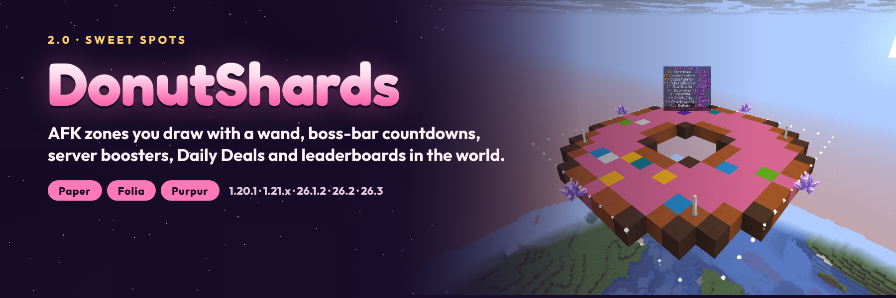

# DonutShards



A shard economy for Paper and Folia servers: players earn shards by standing in **AFK zones** (or at home, at a
reduced rate) and by kills, see every payout coming on a **boss bar**, spend shards in a shop with **Daily Deals**, and
compete on **leaderboards that stand in your world**. Staff draw zones with a wand, give each zone its own payout and
permission, and run **server boosters** for events. Everything is stored in a SQL ledger.

**2.0 "Sweet Spots"** is the biggest update yet: see the [2.0.0 notes](patchnotes/2.0.0.md), the
[design notes](docs/DESIGN-2.0.md) and the [QA record](docs/QA-2.0.0.md) (in-game checks with a real client on ten
Paper and Folia servers).

## Which jar do I download?

There is **one jar for every supported server**: `donutshards-paper-1.20.1-26.3-<version>.jar`. It is a plugin (put it
in `plugins/`), not a mod; players install nothing.

| Your server | Minecraft | Java the server needs | Jar |
|-------------|-----------|-----------------------|-----|
| Paper, Purpur or another Paper fork | 1.20.1 – 1.20.4 | 17+ | `donutshards-paper-1.20.1-26.3-2.0.0.jar` |
| Paper, Purpur or another Paper fork | 1.20.5 – 1.21.11 | 21+ | same jar |
| Paper, Purpur or another Paper fork | 26.1 – 26.3 | 25+ | same jar |
| Folia | 1.20.1 – 26.3 | as above | same jar |
| Spigot or CraftBukkit | any | | not supported (DonutShards uses Paper's API) |

Tested in game on Paper 1.20.1, 1.21.1, 26.1.2, 26.2 and 26.3 and Folia 1.20.1, 1.21.4, 26.1.2, 26.2 and 26.3.

## Features

### Sweet Spots (AFK zones)

- `/shardmanager zone wand`, left-click and right-click two blocks, `/shardmanager zone create <name>`: a box zone
  (the selected blocks plus 2 blocks of headroom, so selecting the floor works). Or `zone pos1`/`pos2` where you stand.
- Per zone: `shards`, `interval`, `permission`, `display-name` (`/shardmanager zone set`).
- A boss bar shows the zone, the next payout, a countdown and the session total; leaving prints a summary.
- Every player has their own timer: it starts when they walk in and stops when they leave or log off.
- `/afk` (home AFK at a reduced rate until you move), `/afk zone` (teleport to a zone), particle outlines.

### Boosters and multipliers

- `/shardmanager booster start <multiplier> <duration> [reason]`: everyone earns more, sees a booster bar, and it
  survives a restart.
- `shards.multiplier.<x>` permissions for ranks. Payout = `floor(base × mode × rank × booster)`, at least 1.

### Shop and Daily Deals

- `/shardshop`: a configurable inventory shop with confirmations and console commands.
- Daily Deals: a row of offers from a pool, the same for everyone, rotating every `rotation-hours`, with a per-player
  limit and a countdown in the lore.

### Leaderboards and history

- `/shardmanager board create <name>`: a live top 10 as a text display in the world.
- `/shards top` (menu with heads, or `chat`), `/shards history`, `/shardmanager info|history <player>`.

### Economy

- SQLite or MariaDB/MySQL ledger, idempotent transactions, atomic taxed `/shards pay` with limits and confirmation.
- Kill rewards, Vault conversion, PlaceholderAPI (`%donutshard_balance%`, `top_1`–`10`, `zone`, `next_reward`,
  `session`, `booster`, …), an async Java API with events.

See [COMMANDS](COMMANDS.md), [PERMISSIONS](PERMISSIONS.md), [CONFIGURATION](CONFIGURATION.md), [API](API.md),
[INSTALLATION](INSTALLATION.md) and [FOLIA_COMPATIBILITY](FOLIA_COMPATIBILITY.md).

## Upgrading from 1.x

Replace the jar. Balances, zones, messages and settings carry over and gain the new keys; an existing shop keeps its
layout with Daily Deals switched off until you enable them.

## Building

Java 25 toolchain (the jar targets Java 17):

```bash
./gradlew build            # unit tests + jar
./gradlew compileMatrix    # compile against the 1.21.1, 26.1.2, 26.2 and 26.3 APIs
./gradlew release          # releases/donutshards-paper-1.20.1-26.3-<version>.jar + SHA256SUMS.txt
```

## Tools

- [`tools/qa/`](tools/qa): real Paper/Folia servers and a real Minecraft client under Xvfb. `shard_checks.py`
  checks every feature in game, `run_matrix.sh` runs it on every server, `marketing_shots.py` takes the listing
  screenshots.
- [`marketing/`](marketing): the listing description and artwork, and how to regenerate it.
- `.github/workflows/publish.yml`: uploads the jar in `releases/` to Modrinth and CurseForge (owner-triggered).

## Links

- [Discord](https://discord.gg/SAmd9fhNhr)
- [Source and issues](https://github.com/MeherBenSalem/DonutShards)
- [Support us](https://nightbeam.dev/support)

When reporting a problem, include the DonutShards version, server software and version, Java version, sanitized logs
and the steps to reproduce. Never post database passwords.

## Contributing

See [CONTRIBUTING.md](CONTRIBUTING.md). Please follow the [Code of Conduct](CODE_OF_CONDUCT.md).

## License

[Apache License 2.0](LICENSE). See [NOTICE](NOTICE).
